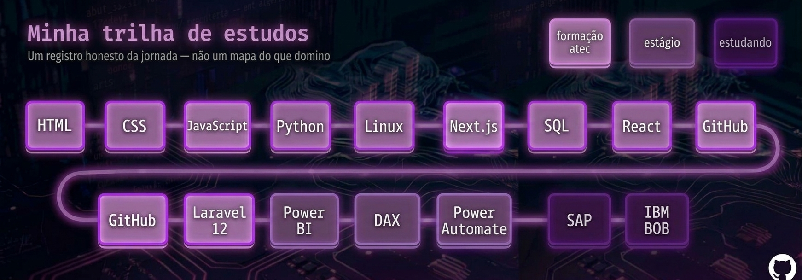

## 🌱 Sobre mim

Olá! Sou a **Gicélia** — estou em transição de carreira para a tecnologia. Depois de mais de 15 anos
resolvendo problemas no mundo administrativo, trago essa experiência para uma nova área: **dados e
desenvolvimento de software**.

Não finjo dominar tudo. O que você vê aqui é um **registro honesto** do que estudei, do que estou
estudando e de onde quero chegar. Busco uma oportunidade para **aplicar o que aprendi** em problemas
reais — e continuar aprendendo todos os dias. Também irei reunir projetos que estavam em outros perfis de 
minha autoria.

- 🎓 Técnica Especialista em Tecnologias e Programação de Sistemas de Informação (ATEC, 2026)
- 📊 Estagiária de Business Intelligence na **Renvolt Energy** — dashboards de KPIs em Power BI
- 💻 Desenvolvedora full-stack do projeto **MEDCEI** (Laravel 12 + Next.js) — Trabalho Final de Curso
- 📍 Matosinhos, Portugal

## 🎲 Minha trilha de estudos*

Um registro honesto da jornada — não um mapa do que domino:

🎲 **Quer ver a trilha de verdade, casa por casa?** Explore a versão interativa:
👉 **[queirozmendes-pro.github.io](https://queirozmendes-pro.github.io)** — clique em cada casa e veja o que
sei sobre cada tecnologia (projetos, contexto e aprendizados).
*Essa imagem é somente ilustrativa, a versão interativa é que terá as atualizações.

## 📊 GitHub em números

## 🤝 Vamos conversar?

Estou aberta a oportunidades de estágio, júnior ou projetos onde eu possa aplicar o que aprendi e
continuar crescendo. 🌱

---
*Feita com Markdown, imagens geradas por mim e muita vontade de aprender.*
